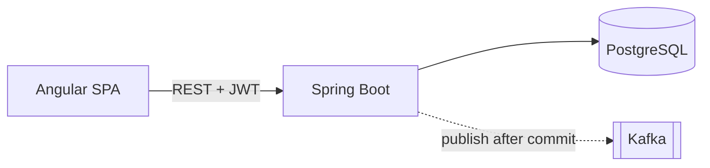
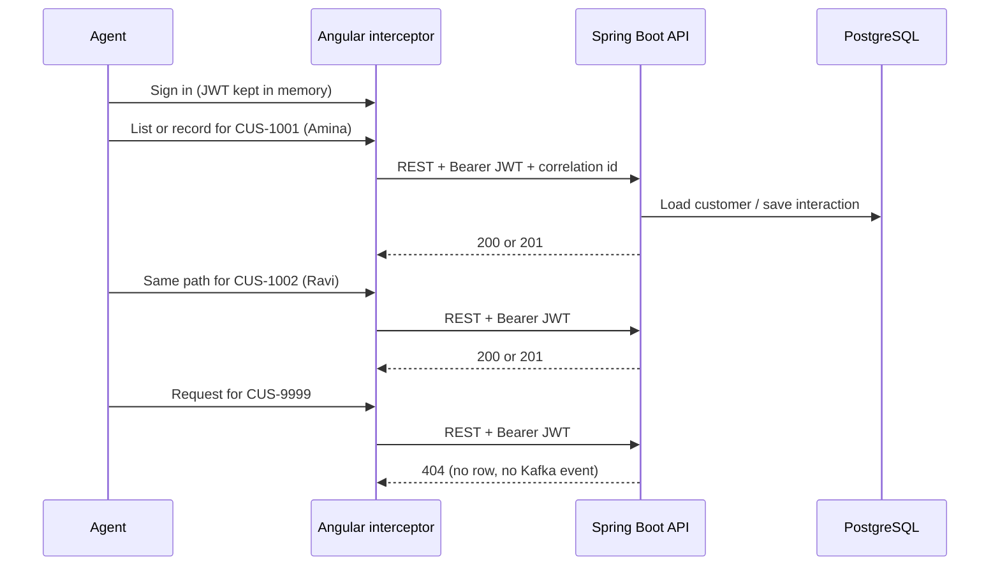

# Northstar CRM Architecture

Agents search a customer, open the profile, and record an interaction (call, email, note, meeting). The Angular app talks to a Spring Boot REST API. The API checks the JWT, saves the note in PostgreSQL, then publishes a versioned Kafka event. GitHub Actions builds and scans the change and deploys a digest-pinned image to the shared k3s cluster behind Traefik Ingress.

## Stack

| Layer | Choice |
| --- | --- |
| Frontend | Angular |
| API | REST / OpenAPI |
| Backend | Spring Boot |
| Database | PostgreSQL |
| Messaging | Kafka |
| Containers | Docker |
| Runtime | k3s (Traefik Ingress) |
| CI/CD | GitHub Actions |
| IaC | Terraform / Ansible |

## Non-goals

Not the taught path: **React**, **SOAP**, **Oracle**, **Bitbucket Pipelines**, and **OpenShift** (`oc`, Routes). We deploy to the **shared k3s cluster**.

## Runtime path

Angular SPA → REST (JWT) → Spring Boot → PostgreSQL.

Spring Boot also talks to Kafka for versioned events, but **PostgreSQL is the system of record**. The API saves the interaction first, commits, then publishes. Kafka never replaces the database. If the customer is missing (`CUS-9999`), the API returns 404 and writes nothing and publishes nothing.

Fixtures: `CUS-1001` Amina Khan (ACTIVE), `CUS-1002` Ravi Singh (PROSPECT), `CUS-9999` not found. Default correlation id `lab-request-001`.

## Delivery path

GitHub → Actions (test, scan, build) → image digest → shared k3s. The delivery Mermaid lives with the Actions plan (#11). The Kafka Mermaid and event field freeze live with the event ADR (#6).

## Application path

## JWT interceptor and customer fixtures

Angular holds the JWT in memory after sign-in. An HTTP interceptor adds `Authorization: Bearer <token>` (and a correlation id) on every API call. Spring Security on the API is the real gate: missing or bad token → 401; wrong role → 403. The interceptor is for UX, not the security boundary.

## Architecture decisions

Short ADRs (written under issues #6, #8, and #11):

| Decision | ADR (lands with) |
| --- | --- |
| Event contract (`CustomerInteractionRecordedV1`, topic, publish-after-commit) | [docs/adrs/001-event-contract.md](adrs/001-event-contract.md) (#6) |
| PostgreSQL as system of record (not Oracle) | [docs/adrs/002-postgresql.md](adrs/002-postgresql.md) (#8) |
| GitHub Actions on a self-hosted runner → digest deploy to k3s | [docs/adrs/003-github-actions-self-hosted-runner.md](adrs/003-github-actions-self-hosted-runner.md) (#11) |

Those files are created by their issues. This overview links them so the Lab 48 pack stays one story.
