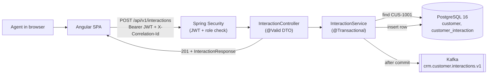
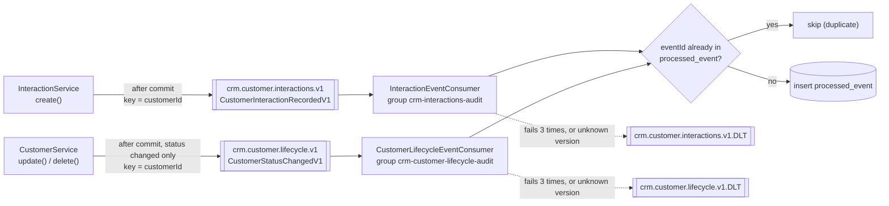
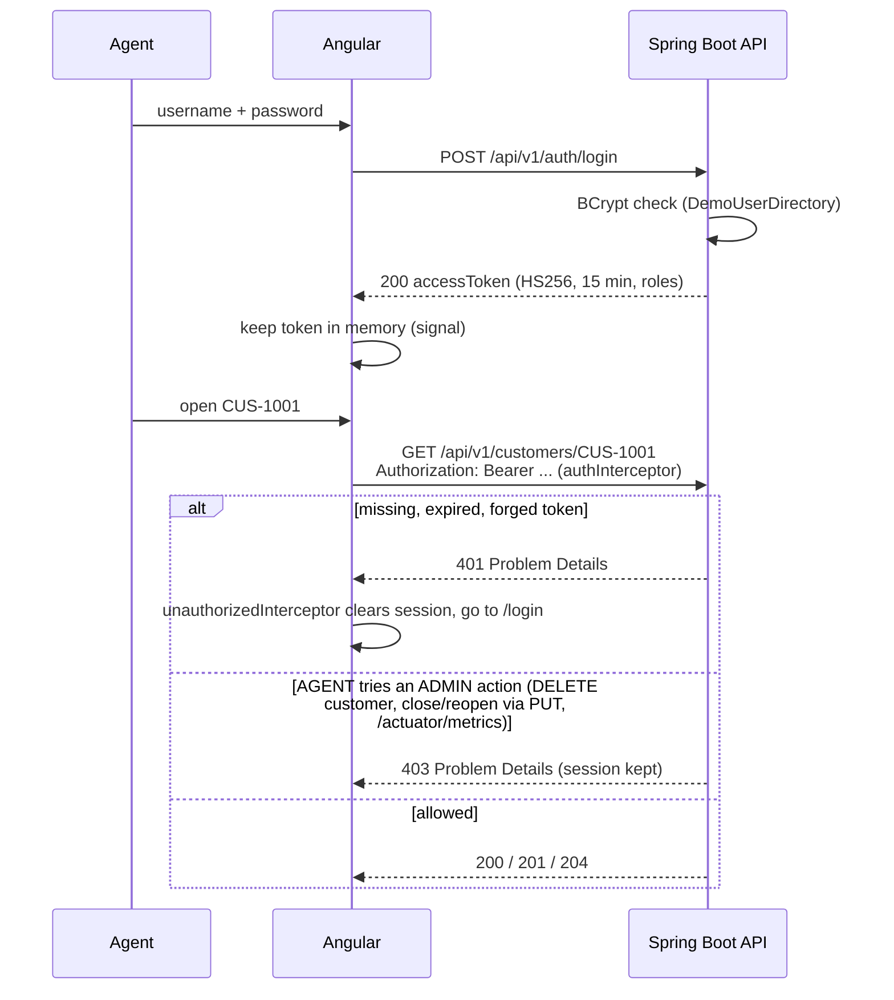
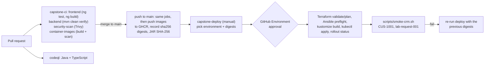

# Northstar CRM Architecture

Agents sign in, search for a customer, open the profile, and record interactions (call, email, note, meeting). Admins can also close or reopen a customer. The Angular app talks to a Spring Boot REST API. The API checks the JWT and the role, saves to PostgreSQL, and then publishes a versioned Kafka event. GitHub Actions tests, scans and builds each change once and publishes images by digest. A manual, approval-gated workflow deploys those digests to the shared k3s cluster behind Traefik Ingress.

More detail: [C4 context](architecture/context.md) · [C4 containers](architecture/container.md) · [NFRs](nfrs.md) · [Lab 48 index](lab48/README.md)

## Stack

| Layer | Choice (version in the repo) |
| --- | --- |
| Frontend | Angular 19 (standalone components, signals, HttpClient interceptors), TypeScript 5.7 |
| API | REST / JSON under `/api/v1`, Problem Details errors (no OpenAPI file yet, see [ADR 005](adrs/005-rest-api-contract.md)) |
| Backend | Spring Boot 3.3, Java 21, Maven |
| Security | Spring Security resource server, HS256 JWT (15 minutes), roles AGENT and ADMIN |
| Database | PostgreSQL 16, Spring Data JPA, Flyway V1–V3 |
| Messaging | Apache Kafka: `crm.customer.interactions.v1`, `crm.customer.lifecycle.v1`, each with a `.DLT` |
| Observability | Spring Boot Actuator (health probes, metrics), `X-Correlation-Id` in every log line |
| Containers | Docker. Backend on `eclipse-temurin:21-jre-alpine`, frontend on `nginx-unprivileged` |
| Runtime | k3s, Traefik Ingress, Kustomize overlays (dev, test, stage, prod-like) |
| CI/CD | GitHub Actions (`capstone-ci`, `codeql`, `capstone-deploy`), Trivy, GHCR |
| IaC | Terraform and Ansible, validate and plan only (see the [Terraform / Ansible plan](terraform-ansible-plan.md)) |
| Tests | JUnit 5, Mockito, Testcontainers (PostgreSQL 16, Kafka 3.8), Karma, Selenium |

## Non-goals

Not the taught path, and not used: **React**, **SOAP**, **Oracle**, and **Bitbucket Pipelines**.

**OpenShift:** the brief and the labs say to deploy to shared k3s, so that's what we built. The rubric docx still names OpenShift, so the platform is an **open question for the instructor** ([ADR 004](adrs/004-k3s-traefik-ingress.md)). We haven't switched anything.

Also out of scope: real customer data (synthetic fixtures only), an external identity provider, and an outbox table.

## Runtime path

Angular SPA → REST (JWT) → Spring Boot → PostgreSQL. Spring Boot ↔ Kafka.

**PostgreSQL is the system of record.** The service saves inside a transaction and publishes to Kafka only **after the commit**. Kafka never replaces the database. An unknown customer (`CUS-9999`) returns `404`, with no row and no event.

Fixtures: `CUS-1001` Amina Khan (ACTIVE), `CUS-1002` Ravi Singh (PROSPECT, used for the PROSPECT → ACTIVE journey), `CUS-9999` (not found). Demo correlation id: `lab-request-001`.

## Diagram 1: application flow (CAP-12, record an interaction)

Unhappy paths: no or bad token → `401`. Bad `interactionType` or empty summary → `400`. `CUS-9999` → `404`. None of these save a row or publish an event (`InteractionApiIT`).

## Diagram 2: Kafka topics and consumers

"Fails 3 times" means the first try plus two retries, 500 ms apart. Field lists are in [ADR 001](adrs/001-event-contract.md).

## Diagram 3: JWT login and API security

The Angular route guard and the hidden "Close" button only make the UI nicer to use. **The API is the security boundary.** Every request is checked again on the server. Full write-up: [ADR 006](adrs/006-jwt-roles.md) and [Lab 51 security notes](lab51/security-and-observability.md).

## Delivery path

GitHub → Actions (test, scan, build once) → GHCR image digest → approved deploy to k3s → smoke → roll back by digest.

Jobs, gates and evidence: [GitHub Actions plan](github-actions-plan.md). Environments: [environment strategy](environment-strategy.md). Step-by-step: [CI/CD runbook](capstone-cicd-runbook.md).

## Trust boundaries

1. **Browser → Ingress/API:** everything from the browser is untrusted. The API validates the JWT, the role and every DTO field.
2. **API → PostgreSQL and Kafka:** reachable only from inside the cluster. The Ingress only exposes `/api`, `/actuator/health` and `/`. Database credentials come from `crm-secrets`.
3. **Kafka → consumers:** consumers check `eventVersion` and dedupe on `eventId`. Anything they can't handle goes to the DLT.
4. **GitHub → cluster:** only `capstone-deploy`, after Environment approval, gets the kubeconfig and runtime secrets (as Environment secrets).

## Architecture decisions

| # | Decision | File |
| --- | --- | --- |
| 001 | Versioned Kafka events, publish after commit, idempotent consumers, DLT | [adrs/001-event-contract.md](adrs/001-event-contract.md) |
| 002 | PostgreSQL 16 + Flyway as the system of record (not Oracle) | [adrs/002-postgresql.md](adrs/002-postgresql.md) |
| 003 | GitHub Actions builds once and promotes image digests | [adrs/003-github-actions-digest-promotion.md](adrs/003-github-actions-digest-promotion.md) |
| 004 | Shared k3s with Traefik Ingress and Kustomize overlays (OpenShift is an open question) | [adrs/004-k3s-traefik-ingress.md](adrs/004-k3s-traefik-ingress.md) |
| 005 | REST contract under `/api/v1`, public ids, Problem Details | [adrs/005-rest-api-contract.md](adrs/005-rest-api-contract.md) |
| 006 | Self-issued HS256 JWT with AGENT and ADMIN, deny by default | [adrs/006-jwt-roles.md](adrs/006-jwt-roles.md) |

## Open questions

| # | Question | What we do until it's answered | Ask |
| --- | --- | --- | --- |
| 1 | Is OpenShift or k3s graded? | Build for k3s | Instructor |
| 2 | Shared cluster access, namespaces, Ingress hosts | Placeholders `northstar-crm-<env>` and `crm-<env>.example.invalid` | Instructor |
| 3 | Where do PostgreSQL and Kafka run on the cluster? | Read from `CRM_DATABASE_URL` and `CRM_KAFKA_BOOTSTRAP_SERVERS` | Instructor |
| 4 | Is CodeQL code scanning required, given the private repo? | Plan for a short public window ([risk R-03](risk-register.md)) | Instructor + team |
| 5 | Node 20 (CI today) or 22 (brief)? | Node 20 | Team |
| 6 | Is an OpenAPI document required? | Contract table in ADR 005 | Instructor |
