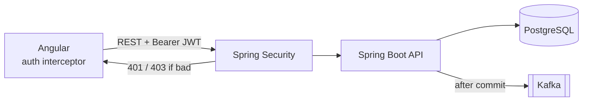
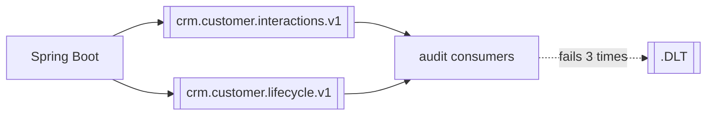
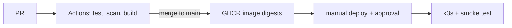

# Northstar CRM architecture

Agents log in, find a customer and record interactions (calls, emails, notes, meetings). Admins can also close and reopen customers. Angular calls our Spring Boot REST API, which checks the JWT, saves to PostgreSQL and then publishes a Kafka event. GitHub Actions builds and tests everything once, and we deploy the image digests to k3s.

| Layer | Tech |
| --- | --- |
| Frontend | Angular 19 |
| Backend | Spring Boot 3.3, Java 21 |
| Security | JWT, roles AGENT and ADMIN |
| Database | PostgreSQL 16 + Flyway |
| Messaging | Kafka |
| Deploy | Docker, GHCR, k3s with Traefik |
| CI/CD | GitHub Actions |
| IaC | Terraform and Ansible (validate only for now) |

## Mandatory runtime path
Angular SPA → REST (JWT) → Spring Boot → PostgreSQL  
Spring Boot ↔ Kafka

## Mandatory delivery path
GitHub → Actions (security / test / build) → k3s

## Non-goals (do not teach as primary path)
- Bitbucket Pipelines
- Oracle
- React
- SOAP

The rubric mentions OpenShift but the labs use k3s, so we went with k3s. TBD, ask the instructor.

## Diagrams

Application and security. The interceptor adds the token, but the API does the real check.

Messaging. Events go out after the DB commit, consumers skip duplicates, and failures end up on a DLT.

Delivery.

## ADRs
1. [Kafka events after commit](adrs/001-event-contract.md)
2. [PostgreSQL](adrs/002-postgresql.md)
3. [GitHub Actions, build once](adrs/003-github-actions-digest-promotion.md)
