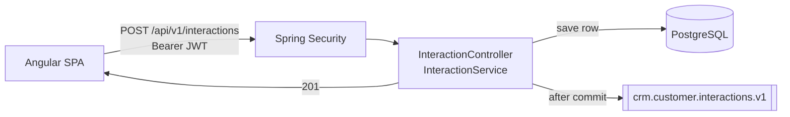
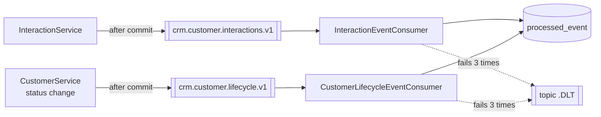
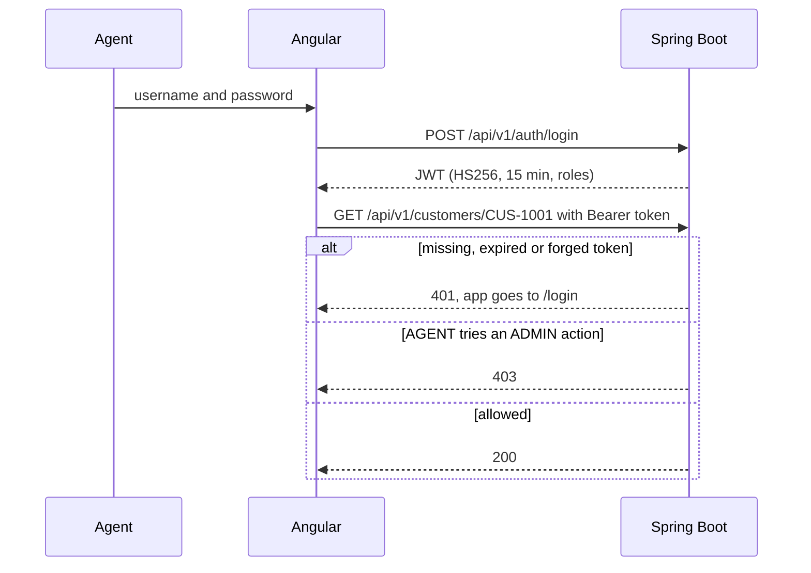
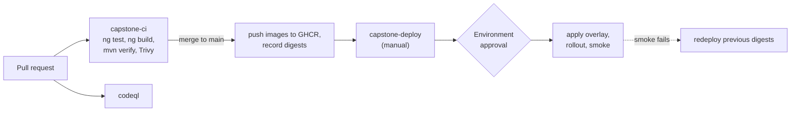

# Northstar CRM architecture

Agents sign in, look up a customer, and record calls, emails, notes and meetings. Admins can also close and reopen customers. The Angular app calls a Spring Boot REST API. The API checks the JWT, saves to PostgreSQL, and publishes a Kafka event after the commit. GitHub Actions tests and builds each change once, and a manual, approved workflow deploys those image digests to k3s.

The C4 views are in [context.md](architecture/context.md) and [container.md](architecture/container.md).

## Stack

| Layer | What we use |
| --- | --- |
| Frontend | Angular 19, TypeScript 5.7 |
| API | REST and JSON under `/api/v1`, Problem Details errors |
| Backend | Spring Boot 3.3, Java 21, Maven |
| Security | Spring Security resource server, HS256 JWT (15 min), roles AGENT and ADMIN |
| Database | PostgreSQL 16, Spring Data JPA, Flyway V1-V3 |
| Messaging | Kafka, two topics, each with a `.DLT` |
| Containers | Docker. Backend on `eclipse-temurin:21-jre-alpine`, frontend on `nginx-unprivileged`. Images in GHCR |
| Runtime | k3s with Traefik Ingress and Kustomize overlays |
| CI/CD | GitHub Actions on GitHub-hosted runners, Trivy, CodeQL |
| IaC | Terraform and Ansible, validate and plan only |
| Tests | JUnit 5, Mockito, Testcontainers, Karma, Selenium |

## Mandatory runtime path

Angular SPA → REST (JWT) → Spring Boot → PostgreSQL  
Spring Boot ↔ Kafka

PostgreSQL is the system of record. The service saves the row in a transaction and publishes to Kafka only after the commit, so Kafka never replaces the database. `CUS-9999` gets a `404` with no row and no event.

Fixtures: `CUS-1001` Amina Khan (ACTIVE), `CUS-1002` Ravi Singh (PROSPECT), `CUS-9999` (not found), correlation id `lab-request-001`.

## Mandatory delivery path

GitHub → Actions (security / test / build) → k3s

CI builds each image once and pushes it to GHCR. The deploy picks images by `sha256` digest, never by tag.

## Non-goals

We don't use Bitbucket Pipelines, Oracle, React or SOAP. Real customer data, an external identity provider and an outbox table are also out of scope.

The rubric names OpenShift, but the brief and the labs say k3s. We built for k3s. Which one is graded is TBD, ask the instructor ([ADR 004](adrs/004-k3s-traefik-ingress.md)).

## Diagrams

### Application flow (CAP-12)

A bad token gets `401`, a bad request gets `400`, and `CUS-9999` gets `404`. None of them save a row or publish an event.

### Messaging

Both topics are keyed by customer id. A consumer skips any `eventId` it already stored in `processed_event`. A record that fails three times, or has an unknown version, goes to that topic's `.DLT`. Event fields are in [ADR 001](adrs/001-event-contract.md).

### JWT and API security

Angular keeps the token in memory and an interceptor adds it to API calls. The route guard and hidden admin buttons are only for the UI. The API is the security boundary and checks the token and role on every request.

### Delivery

Jobs and gates are in the [GitHub Actions plan](github-actions-plan.md). Environments are in the [environment strategy](environment-strategy.md).

## Trust boundaries

- Browser to API. Everything from the browser is untrusted. The API checks the JWT, the role and every DTO field.
- API to PostgreSQL and Kafka. These stay inside the cluster. The Ingress only exposes `/`, `/api` and `/actuator/health`.
- GitHub to cluster. Only `capstone-deploy`, after Environment approval, gets the kubeconfig.

## ADRs

1. [Kafka event contracts and publish after commit](adrs/001-event-contract.md)
2. [PostgreSQL as the system of record](adrs/002-postgresql.md)
3. [GitHub Actions builds once and promotes digests](adrs/003-github-actions-digest-promotion.md)
4. [k3s with Traefik Ingress](adrs/004-k3s-traefik-ingress.md)
5. [REST API contract](adrs/005-rest-api-contract.md)
6. [JWT with AGENT and ADMIN roles](adrs/006-jwt-roles.md)

## Open questions

- k3s or OpenShift? TBD, ask the instructor.
- Cluster access, namespaces, Ingress hosts, and where PostgreSQL and Kafka run on the cluster. TBD, ask the instructor.
- Do we need an OpenAPI document? See CAP-21 in the [backlog](backlog.md).
