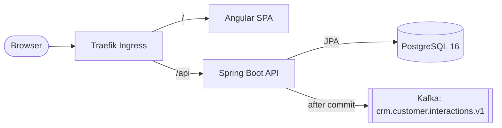

# Containers (C4 level 2)

The deployable units, and how requests and events move between them. This matches [docs/architecture.md](../architecture.md) and the [context view](context.md).

## Deployable units

| Container | Tech | Runs where |
| --- | --- | --- |
| Angular SPA | Angular 19, built once with `ng build` | **FILL IN:** its own image or served by the API (suggest its own image) |
| CRM API | Spring Boot 3.3, Java 21, one image pinned by digest | k3s Deployment in each env namespace |
| PostgreSQL 16 | Flyway-managed schema, system of record | **FILL IN:** shared cluster service or our own (instructor) |
| Kafka | Topic `crm.customer.interactions.v1` | **FILL IN:** shared cluster service or our own (instructor) |
| Traefik Ingress | Built into k3s | Cluster. **FILL IN:** hostnames and Ingress class (instructor). Path split `/` and `/api` is a suggestion |

Locally, Compose runs PostgreSQL and Kafka, and the API and SPA run from the IDE.

## Flows

| Flow | Path |
| --- | --- |
| Record interaction | SPA sends `POST /api/v1/interactions` with Bearer token and `X-Correlation-Id`. API validates, saves, commits, publishes, returns `201` |
| List interactions | SPA sends `GET /api/v1/interactions?customerId=CUS-1001`. API reads newest first from PostgreSQL. No Kafka |
| Unknown customer | `CUS-9999` returns `404`. No row, no event |
| Release | Actions builds each image once, records the digest, and deploys that digest to each namespace. Only ConfigMaps, Secrets, and replicas differ per env |
