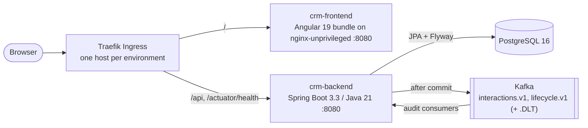

# Containers (C4 level 2)

The deployable units, and how requests and events move between them. This matches [docs/architecture.md](../architecture.md) and the [context view](context.md).

## Deployable units

| Container | Tech | Runs where |
| --- | --- | --- |
| `crm-frontend` | Angular 19 production bundle, built once in CI and copied into `nginxinc/nginx-unprivileged:1.27-alpine`. Uses same-origin `/api` calls | k3s Deployment and Service in each environment namespace (1 replica in dev and test, 2 in stage and prod-like) |
| `crm-backend` | Spring Boot 3.3 on `eclipse-temurin:21-jre-alpine`, running the CI-verified JAR, pinned by digest | k3s Deployment and Service. Startup, readiness (includes the DB) and liveness probes on Actuator |
| PostgreSQL 16 | Flyway V1–V3 schema, system of record | Local: `compose.yaml`. Cluster: **Team to confirm** (URL comes from `CRM_DATABASE_URL`) |
| Kafka | Topics `crm.customer.interactions.v1` and `crm.customer.lifecycle.v1`, plus `.DLT` | Local: `compose.yaml`. Cluster: **Team to confirm** (`CRM_KAFKA_BOOTSTRAP_SERVERS`) |
| Traefik Ingress | Built into k3s, `ingressClassName: traefik` | Cluster. Hosts are placeholders until the instructor assigns them |

Locally, `docker compose up -d` starts PostgreSQL and Kafka only. The API runs with `mvn spring-boot:run` on port 8081 and the SPA with `ng serve` on 4200 (see the README).

## Flows

| Flow | Path |
| --- | --- |
| Sign in | SPA sends `POST /api/v1/auth/login`. The API returns a 15-minute JWT, which the SPA keeps in memory |
| Find a customer | SPA sends `GET /api/v1/customers?q=amina`. The API reads from PostgreSQL. No Kafka |
| Record an interaction | SPA sends `POST /api/v1/interactions` with a Bearer token and `X-Correlation-Id`. The API validates, saves, commits, publishes `CustomerInteractionRecordedV1`, and returns `201` |
| List interactions | SPA sends `GET /api/v1/interactions?customerId=CUS-1001`. The API reads newest first, hiding soft-deleted rows |
| Change status | `PUT /api/v1/customers/CUS-1002` with `ACTIVE`. The API saves and publishes `CustomerStatusChangedV1`. Closing or reopening needs ADMIN |
| Unknown customer | `CUS-9999` returns `404`. No row, no event |
| Release | CI builds each image once and records the digest. `capstone-deploy` pins that digest into the overlay for each namespace. Only ConfigMap values, Secrets, hosts and replicas differ per environment |
