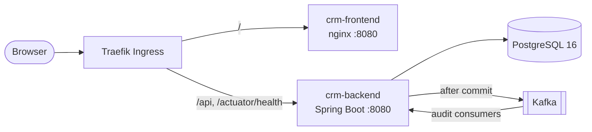

# Containers (C4 level 2)

The pieces we deploy and how traffic moves between them. See also the [context view](context.md).

| Container | What it is | Where it runs |
| --- | --- | --- |
| `crm-frontend` | Angular production bundle on `nginx-unprivileged`. Calls `/api` on the same origin | k3s Deployment, 1 replica in dev and test, 2 in stage and prod-like |
| `crm-backend` | Spring Boot JAR on `eclipse-temurin:21-jre-alpine`, pinned by digest. Startup, readiness and liveness probes on Actuator | k3s Deployment |
| PostgreSQL 16 | Flyway V1-V3 schema | Compose locally. Cluster TBD (`CRM_DATABASE_URL`) |
| Kafka | `crm.customer.interactions.v1` and `crm.customer.lifecycle.v1`, plus `.DLT` | Compose locally. Cluster TBD (`CRM_KAFKA_BOOTSTRAP_SERVERS`) |
| Traefik Ingress | Built into k3s | Hosts are placeholders for now |

Locally, `docker compose up -d` starts only PostgreSQL and Kafka. We run the API with `mvn spring-boot:run` on 8081 and the SPA with `ng serve` on 4200.

## Main flows

- Sign in. `POST /api/v1/auth/login` returns a 15-minute JWT that the SPA keeps in memory.
- Record an interaction. `POST /api/v1/interactions` validates, saves, commits, publishes `CustomerInteractionRecordedV1`, and returns `201`.
- Change status. `PUT /api/v1/customers/CUS-1002` with `ACTIVE` saves and publishes `CustomerStatusChangedV1`. Closing or reopening needs ADMIN.
- Release. CI builds each image once and records the digest. `capstone-deploy` pins that digest into the overlay for each namespace.
