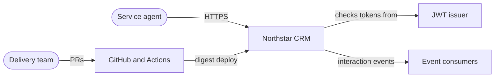

# Context (C4 level 1)

Who uses Northstar CRM, what it depends on, and where the trust lines are. This matches [docs/architecture.md](../architecture.md).

## People

| Who | What they do |
| --- | --- |
| Service agent | Signs in, opens a customer (`CUS-1001`), records and reviews interactions |
| Second role | **FILL IN:** name and permissions of the second role (brief says AGENT / ADMIN; instructor to confirm) |
| Delivery team | Merges through reviewed PRs and releases through Actions |

## External systems

| System | Why we depend on it |
| --- | --- |
| JWT issuer | Signs the tokens the API checks. **FILL IN:** who issues them and how we get a demo token (instructor). Until Lab 51 the API accepts the demo bearer token |
| GitHub and Actions | Source, reviews, CI/CD on our self-hosted runner (team policy) |
| Image registry | Holds images by digest. **FILL IN:** which registry (instructor) |
| Shared k3s cluster | Runs our namespaces behind Traefik Ingress |
| Event consumers | Read `crm.customer.interactions.v1`. **FILL IN:** consumer scope (instructor) |

## Trust boundaries

1. **Browser to Ingress.** The browser is untrusted. Angular keeps the JWT in memory and adds it to calls, but that's convenience, not security.
2. **Ingress to API.** Spring Security is the gate: no or bad token is `401`, wrong role is `403`. The API accepts `X-Correlation-Id` or defaults to `lab-request-001`.
3. **API to PostgreSQL and Kafka.** Inside the cluster only, never exposed through Ingress. Credentials come from k8s Secrets.
4. **GitHub to cluster.** Only the deploy job, behind a GitHub Environment approval, holds cluster credentials.
