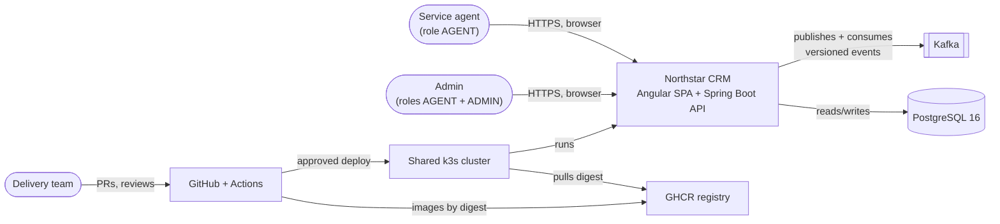

# Context (C4 level 1)

Who uses Northstar CRM, what it depends on, and where the trust lines are. This matches [docs/architecture.md](../architecture.md). The next level down is the [container view](container.md).

## People

| Who | What they do |
| --- | --- |
| Service agent (`agent`, role AGENT) | Signs in, searches customers, opens `CUS-1001`, records, edits and soft-deletes interactions, creates customers and moves Ravi `PROSPECT → ACTIVE` |
| Admin (`admin`, roles AGENT + ADMIN) | Everything an agent can do, plus close or reopen a customer and read `/actuator/metrics` |
| Delivery team | Merges through reviewed PRs and releases through Actions |

Both accounts are synthetic demo users. The API signs in-house tokens, so there's no outside login service.

## External systems

| System | Why we depend on it | Status |
| --- | --- | --- |
| PostgreSQL 16 | System of record | Local: Compose. Cluster: **Team to confirm** (instructor-provided or ours) |
| Kafka | Interaction and lifecycle events | Local: Compose (`apache/kafka:3.8.0`). Cluster: **Team to confirm** |
| GitHub and Actions | Source, reviews, CI/CD on hosted `ubuntu-latest` runners | In use. CI runs on PR #22 |
| GHCR | Holds images, which are deployed by `sha256` digest | Pushes happen only on `main` and tags, so nothing has been published yet |
| Shared k3s cluster | Runs our namespaces behind Traefik Ingress | **Team to confirm** access, namespaces and hosts |

## Trust boundaries

1. **Browser to Ingress.** The browser is untrusted. Angular keeps the JWT in memory and adds it to calls, but that's convenience, not security.
2. **Ingress to API.** Spring Security is the gate. No token or a bad one gets `401`, and the wrong role gets `403`. The API accepts `X-Correlation-Id` if it's safe (64 characters at most, letters, digits and `._:-`), otherwise it generates one, and it echoes the value back.
3. **API to PostgreSQL and Kafka.** Inside the cluster only, never exposed through Ingress. Credentials come from the `crm-secrets` Kubernetes Secret.
4. **GitHub to cluster.** Only the `capstone-deploy` job, behind a GitHub Environment approval, holds cluster credentials.
