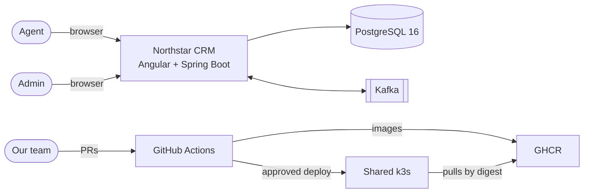

# Context (C4 level 1)

Who uses Northstar CRM and what it depends on. The next level down is the [container view](container.md).

## People

- Agent (`agent`, role AGENT) searches customers, creates and updates them, and records, edits and deletes interactions.
- Admin (`admin`, roles AGENT and ADMIN) can do the same, and can also close or reopen a customer and read `/actuator/metrics`.
- Our team merges through reviewed PRs and releases through Actions.

Both accounts are demo users. The API issues its own tokens, so there is no outside login service.

## External systems

| System | Local | Cluster |
| --- | --- | --- |
| PostgreSQL 16 | Docker Compose | TBD, ask the instructor |
| Kafka | Docker Compose (`apache/kafka:3.8.0`) | TBD, ask the instructor |
| GitHub Actions | Runs on PR #22 | Same |
| GHCR | Not used | Images pushed from `main` only, none yet |
| Shared k3s | Not used | Access, namespaces and hosts TBD |

## Trust boundaries

The browser is untrusted. Spring Security is the gate: no token or a bad one gets `401`, and the wrong role gets `403`. PostgreSQL and Kafka are never exposed through the Ingress. Only the `capstone-deploy` job holds cluster credentials, and only after approval.
